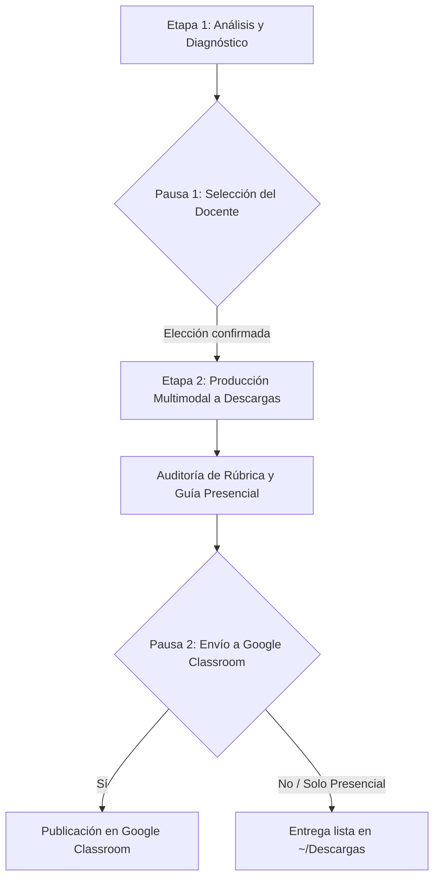

# Skill: Generar Clase Didáctica Multimodal

Esta skill gestiona el ciclo completo de diseño de una clase interactiva, combinando recomendaciones pedagógicas precisas, generación de activos multimodales (Nano Banana 2.1, Veo 3.1, TTS, Workspace) y soporte presencial y virtual.

## Flujo Interactivo Obligatorio (3 Etapas con 2 Pausas)

---

### ETAPA 1: Análisis del Curso, Contenido y Menú de Selección (PAUSA 1)

1. **Recepción de Datos del Docente:**
   - **Tema a trabajar.**
   - **Curso / Nivel o edad de los estudiantes** (ej. 1ro de Bachillerato, 7mo de Básica, Inicial).
   - **Contenido base / Cuaderno de NotebookLM** (leer fuentes o notas).
   - **Planificación de la sesión** (Inicio, Desarrollo y Cierre con sus tiempos).
   - **Rúbrica de evaluación** (criterios, porcentajes y descriptores).

2. **Evaluación Pedagógica:**
   - Consulta `references/matriz_idoneidad_cursos.md`.
   - Evalúa qué recursos maximizan el aprendizaje activo y la retención según la edad del alumnado.

3. **Presentación del Menú al Docente:**
   - Emite un **Diagnóstico Breve de Idoneidad**.
   - Muestra el **Catálogo Numerado de Recursos**, marcando con `[★ IDÓNEO PARA TU CURSO Y CONTENIDO]` los recomendados:
     - `[1]` **Infografía / Mapa Visual / Flashcards** (Imagen alta resolución para proyector o impresión).
     - `[2]` **Presentación de Diapositivas de la Clase** (Google Slides + `.pptx` / `.pdf` en Inicio, Desarrollo y Cierre).
     - `[3]` **Vídeo Didáctico / Gancho Visual** (Clip `.mp4` generado con Veo 3.1 para activar conocimientos o ilustrar procesos).
     - `[4]` **Cuestionario / Evaluación / Ticket de Salida** (Google Forms + `.pdf` con solucionario).
     - `[5]` **Guía de Estudio y Hoja de Taller Práctico** (Google Docs + `.docx` / `.pdf` con actividades de aula).
     - `[6]` **Matriz de Rúbrica Calificable y Lista de Cotejo** (Google Sheets + `.xlsx` con fórmulas).
     - `[7]` **Cápsula de Audio / Narración Didáctica** (Archivo `.mp3` generado con TTS para accesibilidad y escucha activa).
     - `[8]` **Mini-Aplicación o Simulador Web Interactivo Offline** (Archivo `.html` autocontenido para usar en clase sin internet).

4. **🛑 PAUSA OBLIGATORIA 1 (Esperar confirmación):**
   - Pregunta al docente:
     > *"¿Cuáles de estos recursos deseas que construya hoy? (Puedes indicar los números, ej. `1, 2, 3, 5`, responder `recomendados` o `todos`)."*
   - **NO generes ningún archivo hasta recibir su respuesta.**

---

### ETAPA 2: Producción Multimodal y Guardado en `Descargas` para Clases Presenciales

1. **Creación de Carpeta Presencial:**
   - Llama a `prepare_presencial_downloads_folder` del servidor MCP `lab-studio`.
   - Se crea `~/Descargas/Lab_Didactico_[Curso]_[Tema]_[Fecha]/`.

2. **Ejecución Paralela de Subagentes:**
   - Invoca a `disenador-instruccional` para los materiales de texto, diapositivas, hojas de trabajo, evaluaciones y simulador HTML.
   - Invoca a `productor-multimedia` para infografías (Nano Banana 2.1), clips de vídeo (Veo 3.1) y locución en audio (TTS).

3. **Empaquetado Offline:**
   - Cada recurso seleccionado debe guardarse físicamente en la carpeta de `Descargas`.
   - Genera el índice estructurado `00_GUIA_DOCENTE_PRESENCIAL.md` detallando en qué minuto de la clase utilizar cada archivo físico de la carpeta.

4. **Auditoría de Calidad:**
   - Invoca a `auditor-calidad-rubrica` para certificar que el 100% de los criterios de la rúbrica estén cubiertos por las actividades y recursos producidos.

---

### ETAPA 3: Entrega Local y Despliegue en Google Classroom (PAUSA 2)

1. **Presentación de Resultados Locales:**
   - Muestra la lista de archivos creados y la ruta absoluta en `Descargas`.
   - Muestra la tabla de trazabilidad entre recursos y rúbrica.

2. **🛑 PAUSA OBLIGATORIA 2 (Consulta de Publicación Virtual):**
   - Pregunta explícitamente:
     > *"Tus archivos para la clase presencial ya están listos en tu carpeta de Descargas. ¿Deseas que envíe y publique ahora estos recursos en **Google Classroom** para tus clases virtuales? Si es así, indícame:*
     > *1. El nombre o ID del curso en Classroom (o dime si quieres que liste tus cursos activos).*
     > *2. Si prefieres publicarlos como **Material de clase**, como **Tarea evaluada** (adjuntando la rúbrica y fecha de entrega), o guardarlos como **Borrador**."*

3. **Publicación Opcional:**
   - Si el docente confirma, sube los archivos a Drive y crea la tarea/material en Classroom mediante las herramientas de Google Workspace.
